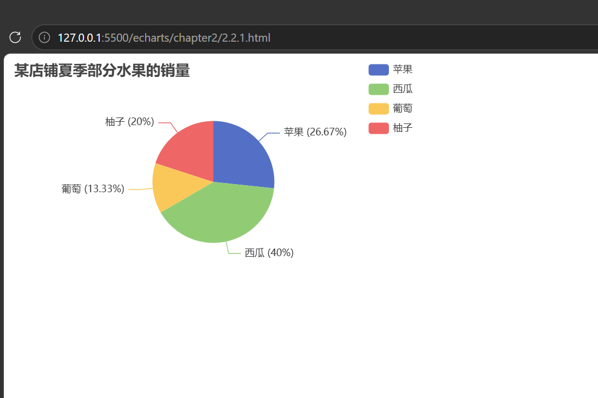

# 总结

## 代码

```
<!DOCTYPE html>
<html lang="zh-CN">
<head>
    <meta charset="UTF-8">
    <title>基础饼图 - 水果销量</title>
    <script src="https://cdn.jsdelivr.net/npm/echarts@5.4.3/dist/echarts.min.js"></script>
</head>
<body>
    <div id="main" style="width: 500px; height: 300px;"></div>

<script>
    var myChart = echarts.init(document.getElementById('main'));
    var option = {};

    var option = {
        title: {
            text: '某店铺夏季部分水果的销量'
        },
        legend: {
            right: 0,
            orient: 'vertical'
        },
        series: [
            {
                type: 'pie',
                radius: 75,
                data: [
                    { value: 400, name: '苹果' },
                    { value: 600, name: '西瓜' },
                    { value: 200, name: '葡萄' },
                    { value: 300, name: '柚子' }
                ],
                label: {
                    formatter: '{b} ({d}%)'
                }
            }
        ]
    };

    option && myChart.setOption(option);
</script>
</body>
</html>
```



### 拓展

series: [
{
type: 'pie',
radius: ['40%', '75%'],
data: [
{ value: 400, name: '苹果' },
{ value: 600, name: '西瓜' },
{ value: 200, name: '葡萄' },
{ value: 300, name: '柚子' }
],
label: {
formatter: '{b}\n{d}%'
}
}
]

