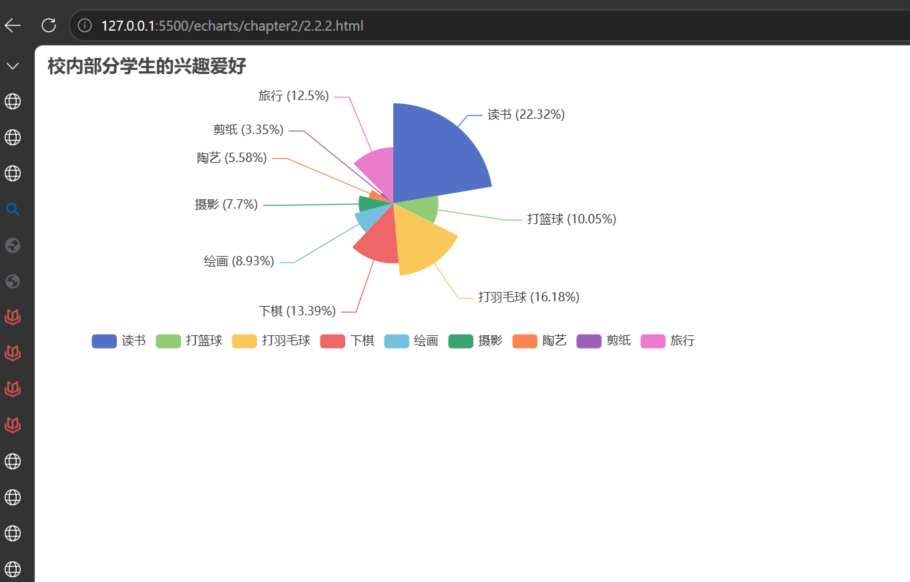

# 总结

## 代码

```
<!DOCTYPE html>
<html lang="zh-CN">
<head>
    <meta charset="UTF-8">
    <title>南丁格尔玫瑰图</title>
    <script src="https://cdn.jsdelivr.net/npm/echarts@5.4.3/dist/echarts.min.js"></script>
</head>
<body>
    <div id="main" style="width: 700px; height: 300px;"></div>
<script>
    var myChart = echarts.init(document.getElementById('main'));
    var option = {};

    var option = {
        title: {
            text: '校内部分学生的兴趣爱好'
        },
        legend: {
            top: 'bottom'
        },
        series: [
            {
                type: 'pie',
                radius: 100,
                roseType: 'radius',
                data: [
                    { value: 200, name: '读书' },
                    { value: 90, name: '打篮球' },
                    { value: 145, name: '打羽毛球' },
                    { value: 120, name: '下棋' },
                    { value: 80, name: '绘画' },
                    { value: 69, name: '摄影' },
                    { value: 50, name: '陶艺' },
                    { value: 30, name: '剪纸' },
                    { value: 112, name: '旅行' }
                ],
                label: {
                    formatter: '{b} ({d}%)'
                }
            }
        ]
    };

    option && myChart.setOption(option);
</script>
</body>
</html>
```



### 拓展

series: [
{
type: 'pie',
roseType: 'radius',
radius: 80,
center: ['25%','50%'],
data: [
{ value:200, name:'读书' },
{ value:90, name:'打篮球' }
]
},
{
type: 'pie',
roseType: 'radius',
radius: 80,
center: ['70%','50%'],
data: [
{ value:145, name:'羽毛球' },
{ value:120, name:'下棋' }
]
}
]

