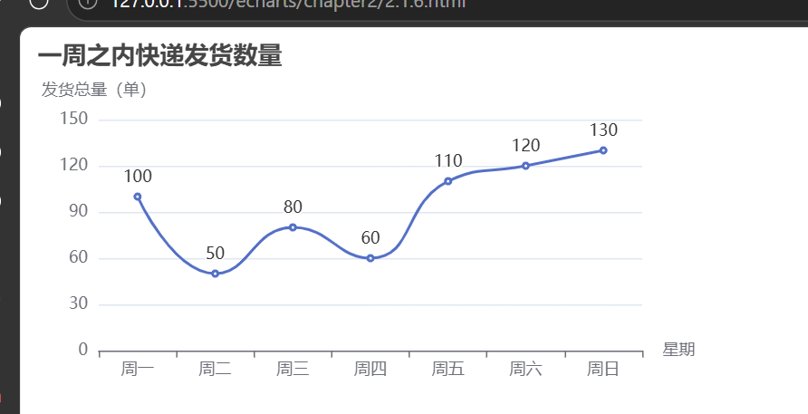

# 总结

## 源代码

```
<!DOCTYPE html>
<html lang="zh-CN">
<head>
    <meta charset="UTF-8">
    <title>平滑曲线图-一周快递发货数量</title>
    <script src="https://cdn.jsdelivr.net/npm/echarts@5.4.3/dist/echarts.min.js"></script>
</head>
<body>
    <!-- 图表容器 -->
    <div id="main" style="width: 500px; height: 300px;"></div>

<script>
    // 初始化ECharts实例
    var myChart = echarts.init(document.getElementById('main'));
    var option = {};

    // 配置项
    var option = {
        title: {
            text: '一周之内快递发货数量'
        },
        dataset: {
            source: [
                ['time', 'count'],
                ['周一', 100],
                ['周二', 50],
                ['周三', 80],
                ['周四', 60],
                ['周五', 110],
                ['周六', 120],
                ['周日', 130]
            ]
        },
        xAxis: {
            name: '星期',
            type: 'category'
        },
        yAxis: {
            name: '发货总量（单）'
        },
        series: [
            {
                type: 'line',
                smooth: true,
                label: {
                    show: true
                }
            }
        ]
    };

    // 渲染图表
    if(option && myChart){
        myChart.setOption(option);
    }
</script>
</body>
</html>
```

## 图片



## 拓展

series: [
{
type: 'line',
smooth: 0.5, // 0.5中等平滑，介于折线和完全平滑之间
name: '发货量',
lineStyle:{
color:'#0066cc',
width:2
},
itemStyle:{
color:'#ff4400'
},
label: {
show: true,
position:'top'
}
}
]
series: [
{
type: 'line',
smooth: true,
name: '发货量',
label: {show: true}
},
{
type: 'line',
smooth: true,
name: '退款单',
label: {show: true}
}
],
legend:{
data:['发货量','退款单']
}

