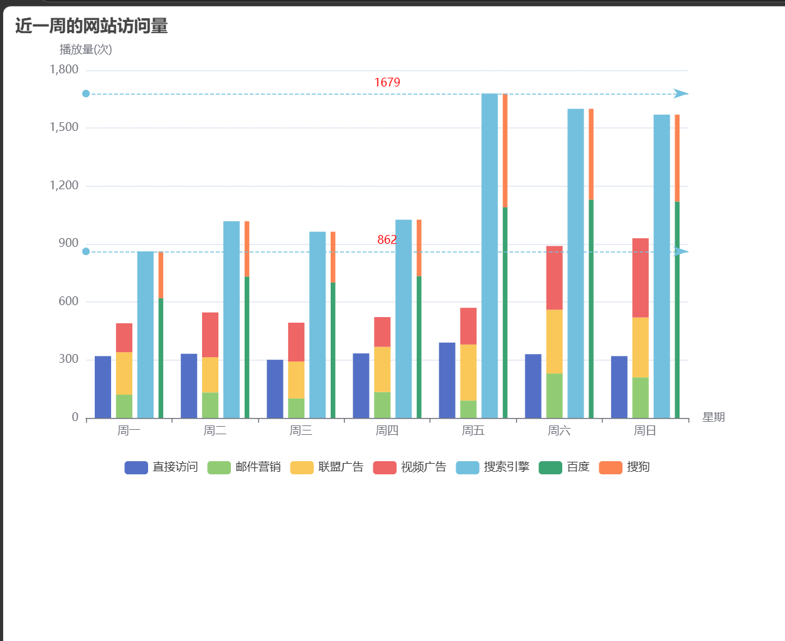
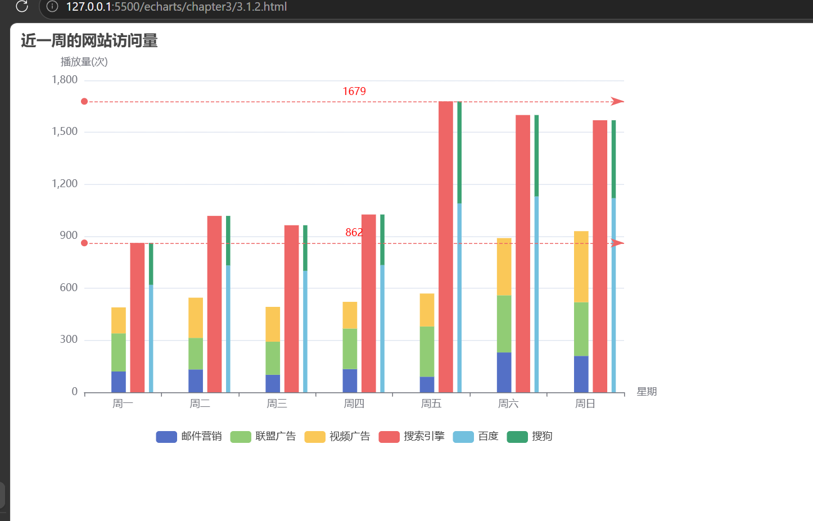

## 总结

## 源代码

```
<!DOCTYPE html>
<html lang="en">

<head>
    <meta charset="UTF-8">
    <meta name="viewport" content="width=device-width, initial-scale=1.0">
    <title>近一周的网站访问量</title>
    <script src="../echarts.js"></script>
</head>

<body>
    <div id="main" style="width:800px; height:500px;"></div>
    <script>
        var myChart = echarts.init(document.getElementById('main'));
        var xDataArr = ['周一', '周二', '周三', '周四', '周五', '周六', '周日'];
        var option = {
            title: {
                text: '近一周的网站访问量'
            },
            xAxis: {
                name: '星期',
                type: 'category',
                data: xDataArr
            },
            yAxis: {
                name: '播放量(次)',
                type: 'value'
            },
            legend: {
                bottom: 5
            },
            series: [
                {
                    name: '直接访问',
                    type: 'bar',
                    data: [320, 332, 301, 334, 390, 330, 320],
                    emphasis: {
                        focus: 'series',
                        label: {
                            show: true
                        }
                    }
                },
                {
                    name: '邮件营销',
                    type: 'bar',
                    stack: 'ad',
                    barGap: '30%',
                    data: [120, 132, 101, 134, 90, 230, 210],
                    emphasis: {
                        focus: 'series'
                    }
                },
                {
                    name: '联盟广告',
                    type: 'bar',
                    stack: 'ad',
                    data: [220, 182, 191, 234, 290, 330, 310],
                    emphasis: {
                        focus: 'series'
                    }
                },
                {
                    name: '视频广告',
                    type: 'bar',
                    stack: 'ad',
                    data: [150, 232, 201, 154, 190, 330, 410],
                    emphasis: {
                        focus: 'series'
                    }
                },
                {
                    name: '搜索引擎',
                    type: 'bar',
                    data: [862, 1018, 964, 1026, 1679, 1600, 1570],
                    emphasis: {
                        focus: 'series'
                    },
                    markLine: {
                        label: {
                            position: 'middle',
                            color: 'red'
                        },
                        lineStyle: {
                            type: 'dashed'
                        },
                        data: [{ type: 'min' }, { type: 'max' }]
                    }
                },
                {
                    name: '百度',
                    type: 'bar',
                    barWidth: 5,
                    stack: 'searchEngines',
                    data: [620, 732, 701, 734, 1090, 1130, 1120],
                    emphasis: {
                        focus: 'series'
                    }
                },
                {
                    name: '搜狗',
                    type: 'bar',
                    stack: 'searchEngines',
                    data: [242, 286, 263, 292, 589, 470, 450],
                    emphasis: {
                        focus: 'series'
                    }
                }
            ]
        };
        myChart.setOption(option);
    </script>
</body>

</html>
```



### 扩展组件
```
series:[{
    type:'bar',
    itemStyle:{ // 柱样式
        color:'#3398db',
        barBorderRadius:[4,4,0,0] // 柱圆角
    },
    label:{show:true}, // 常态直接显示数值（非悬浮）
    barCategoryGap:'20%', // 不同类目之间空隙
    markPoint:{ // 标记点，最大值最小值标记
        data:[{type:'max'},{type:'min'}]
    },
    silent:false, // 是否关闭鼠标交互
}]
```
