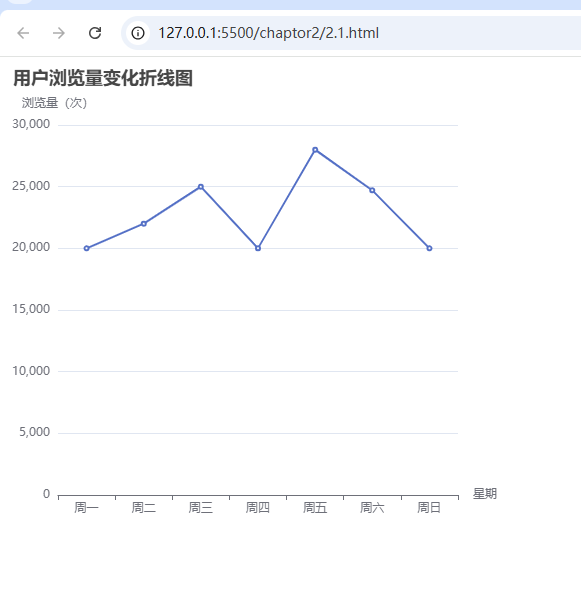

# 总结

## 案例代码
<!DOCTYPE html>
<html lang="en">

<head>
    <meta charset="UTF-8">
    <meta name="viewport" content="width=device-width, initial-scale=1.0">
    <title>Document</title>
    <!-- 导入ehcarts -->
    
</head>
<!-- 创建div容器  1 唯一属性 2 宽 高 -->

<body>

</body>

</html>

## 案例效果图

## 标题组件 text；“ ”
## 坐标轴组件 xAxis name type data   yxAis name type
## 系列组件 seris type‘line’折线图 data一一对应
